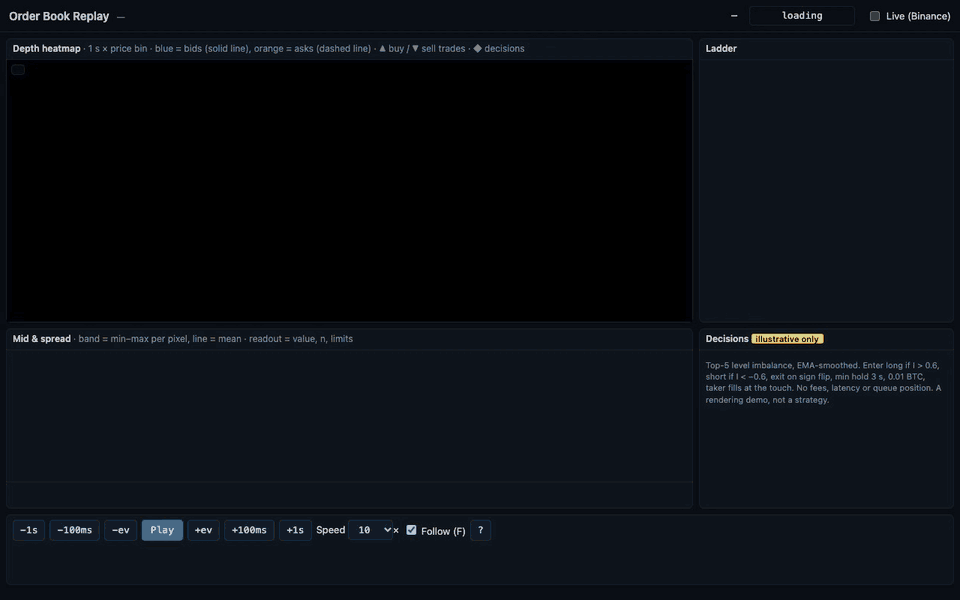
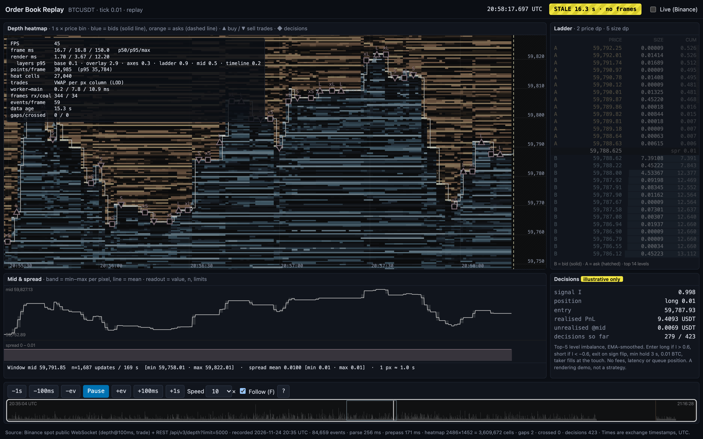

# Order Book Replay

Replay and live view of a real BTCUSDT L2 order book, rendered by hand with Canvas 2D + SVG, no charting library.

Not a trading system or a latency benchmark of exchange connectivity; the strategy overlay is a deliberately simple, illustrative example.

**Live demo:** https://mariuszbyahoo.github.io/orderbook-replay/



<sub>23 s, recorded with Playwright on the production build. Play at 10× → 50× → seek → live mode → STALE (the
engine worker is deliberately stalled for 3 s). Recorded with `prefers-reduced-motion`, so the time window
pages instead of scrolling. That is a real app mode, used here to keep the GIF under 8 MB.</sub>

### Measured

Conditions for every row: Apple M4, macOS 26.5, Chromium 159.0.8154.6 (headed), production build (`vite build`) served statically by `scripts/serve.ts`, 1600×1000 CSS px at DPR 2. Raw data: [`perf/results.json`](perf/results.json),
[`perf/live.json`](perf/live.json), and every live run on that day in
[`perf/live-history.json`](perf/live-history.json).

| What                              | Result                                                          | Sample                           |
| --------------------------------- | --------------------------------------------------------------- | -------------------------------- |
| Frame interval, replay at 100×    | p50 16.7 / p95 17.0 / max 17.8 ms (60.0 fps on a 60 Hz display) | 3600 frames over 60 s            |
| Main-thread render work per frame | p50 2.4 / p95 3.9 / max 3.9 ms                                  | same run                         |
| Points per frame                  | p50 349,032, of which 338,400 are heatmap cells                 | same run, 15 min × ±100 USD view |
| Live data age on screen           | p50 347 / p95 481 / max 1354 ms; 0 of 3601 frames stale         | 60 s live, 2026-11-25 14:25 UTC  |

**What "live data age" measures.** At each rendered frame it is:

```
(local clock + offset to Binance server time) − exchange timestamp of the newest applied event
+ wall time since the worker produced the frame
```

That covers Binance's 100 ms depth batching, network transit from the measuring machine, the error in
the clock-offset estimate (about ±RTT/2; REST round trip p50 282 ms in that run),
the browser's WebSocket delivery, and the app's own worker → render hop. **It is not render latency.**
The app's own share is the worker → rendered frame time: p50 10 / max 20 ms in the same run.

For comparison, a Node process measured the depth stream on its own during the same 60 s and saw an event
age of p50 255 / p95 305 / max 785 ms. Inside the browser, before rendering, the event
age was p50 334 / p95 466 / max 1346 ms. The difference sits upstream of the app's
worker and has not been isolated further.

There were four earlier live runs that day, all kept in `perf/live-history.json`:

- Two had no concurrent baseline and showed p95 values of 2.5 s and 7.7 s.
- One had a concurrent Node baseline and was normal: app p95 298 ms, 0 stale frames.
- One was worse than its concurrent baseline: app p95 1,265 ms with 146 stale frames, against a Node
  p95 of 316 ms. That run predates the stale-cause breakdown, so its cause is unknown.

The connection was unstable that day. Whenever data aged past 1.5 s, the STALE indicator flagged it.

## What it shows

- **Dense data visualisation.** A depth heatmap of price × time × liquidity. Each frame draws it with one
  scaled `drawImage` of a pre-coloured raster, so the JavaScript work does not grow with the number of
  visible cells. GPU work does grow with pixels; the measured run above drew about 338k cells per frame
  at 60 fps.
- **Replay.** A deterministic replay clock runs in a Web Worker. It supports play/pause, stepping
  (one event / 100 ms / 1 s), seek, and 1×–100× speed.
- **Measured rendering performance.** A perf HUD runs all the time; `npm run bench` and
  `scripts/bench-live.ts` write the files above.
- **A visible staleness indicator.** The UI turns visibly stale instead of passing old data off as
  current. This is covered by unit tests and an e2e test that stalls the worker.

## Quick start

```bash
nvm use            # Node 22
npm ci
npm run dev        # http://127.0.0.1:5173/
npm test           # unit tests (Vitest)
npm run lint       # ESLint + Prettier check
npm run build      # static output in dist/ (relative base: works under any sub-path)
npm run e2e        # Playwright checks against dist/ + screenshots into docs/
npm run bench      # 60 s benchmark at 100x -> perf/results.json
npm run bench:live # 60 s live data age + concurrent Node baseline -> perf/live.json
npm run gif        # docs/demo.gif (needs ffmpeg)
npm run record -- --minutes 45   # record a fresh session from Binance
npm run sample                   # trim data/session.jsonl.gz -> public/data/sample.jsonl.gz
```

Replay mode needs no backend, only a static file server. Browsers block module workers and `fetch` on
`file://`, so opening `dist/index.html` directly from disk does not work. Use any static server, for
example `npx tsx scripts/serve.ts`, which serves `dist/` at `/p/orderbook-replay/`.

## Data

- **Source:** Binance spot public market data, with no API key. Three inputs are combined:
  `btcusdt@depth@100ms` (diff depth), `btcusdt@trade`, and a REST snapshot from
  `GET /api/v3/depth?limit=5000`. The data was recorded with `scripts/record.ts`. Use of the data is
  subject to Binance's Terms of Use. This repository redistributes a small trimmed sample for
  demonstration only.
- **Sync:** the recorder follows Binance's "How to manage a local order book correctly" procedure
  (`binance-spot-api-docs/web-socket-streams.md`) step by step. That logic lives in a pure state
  machine, `src/engine/binanceSync.ts`, which has unit tests. The steps are:
  1. Buffer stream events and note `U` of the first one.
  2. Fetch a snapshot. If `lastUpdateId < U`, fetch again.
  3. Drop buffered events with `u <= lastUpdateId`. The first remaining event must straddle `lastUpdateId`.
  4. For each event after that: ignore it if `u < id`. If `U > id + 1` it is a **gap**: write a `gap`
     record, discard the book and resync from a new snapshot.
- **Continuity:** the recorder checks `U == prev u + 1` on every event and logs any break. The replay
  engine checks continuity again independently, and counts gaps and crossed books (best bid ≥ best ask).
  The counts for the shipped sample are shown in the footer and in the HUD.
- **Timestamps:** every record keeps the exchange time (`E` for depth, `T` for trades) and the local
  receive time `t`. The time axis uses exchange time, clamped to be monotonic. The number of clamped
  records is reported. The REST snapshot has no timestamp of its own, so its time is taken from the
  first diff applied on top of it.
- **Committed sample** (`public/data/sample.jsonl.gz`): produced by `scripts/make-sample.ts`. It keeps
  only price levels inside one fixed band: the session's traded range ±0.5 %. Diffs carry absolute
  quantities, so within a fixed band the reconstruction does not depend on levels outside it. This follows from
  the format; it was not separately checked against the untrimmed recording. Levels outside the band are
  simply absent. Depth records keep their `U`/`u` even when no level survives, so the continuity
  checks still run on every event.

**The shipped sample** (`public/data/sample.jsonl.gz`, 3.27 MB):

|              |                                                                                                                                     |
| ------------ | ----------------------------------------------------------------------------------------------------------------------------------- |
| Session      | 2026-11-24, 20:35:03 → 21:16:28 UTC (41 min 25 s), BTCUSDT                                                                          |
| Records      | 84,659 events: 21,940 depth diffs, 62,715 trades, 2 snapshots, 2 gaps; 698,921 price levels                                         |
| Traded range | 59,481.33 – 59,908.01 USDT. Kept band 59,182.86 – 60,206.48                                                                         |
| Continuity   | 0 ignored events, 0 crossed books. 1,288 records had their time clamped (trade `T` and depth `E` interleave on the combined stream) |

The two gaps are both real. Neither was injected:

1. **21:14:04 UTC:** the WebSocket closed with code 1006. The recorder logged a `gap`, reconnected,
   and resynced from a new snapshot 3 s later. During replay the book is shown as **INVALID** until
   that snapshot arrives.
2. **21:16:28 UTC:** a second 1006 close. The reconnect attempt failed with only an `error` event and
   no `close`, so the recorder sat idle until its timer ended. The data therefore stops at 41 minutes
   instead of 50. This was a recorder bug, now fixed: one reconnect path is shared by close, error and
   a 10-second silence watchdog. Live mode got the same watchdog. The sample keeps the trailing gap,
   so the replay ends with the book marked invalid.

## Architecture

```
 Binance WS (depth@100ms + trade) ─┐            ┌───────────────── Web Worker (engine.worker.ts) ──────────────────┐
 Binance REST /depth snapshot ─────┼─ record ─▶ │ loadSession: gzip JSONL ─▶ Session (columnar typed arrays)       │
                                   │  (.jsonl.gz)│ prepass (one pass):                                              │
                                   │            │   ReplayEngine ─ OrderBook (sorted Float64Array per side)         │
                                   │            │     └ checkpoints every 15 s (seek = restore + roll forward)     │
                                   │            │   Analyzer ─ 1 s buckets: mid/spread min/max/sum/n, event counts │
                                   │            │            ─ heatmap raster (Uint8 per bucket × price bin)       │
                                   │            │            ─ ImbalanceStrategy decisions                         │
                                   │            │   raster ─▶ OffscreenCanvas ─▶ ImageBitmap (transferred)         │
                                   │            │ Replay clock (16 ms tick): playT += wall dt × speed; advanceTo()  │
                                   └─ live ───▶ │ Live: DepthSync + OrderBook + Analyzer, patches every 250 ms     │
                                                └───────────────┬───────────────────────────────────────────────────┘
                                                                │ postMessage: 'reset' (history, once),
                                                                │ 'patch' (live appends), 'frame' (latest state, ~60/s)
                                                ┌───────────────▼─────────────── Main thread (render only) ─────────┐
                                                │ History: stats + raster canvas + trades + decisions (append-only) │
                                                │ rAF loop: take the LATEST frame (older ones are coalesced)        │
                                                │   Heatmap  base canvas  (1 drawImage; redrawn only if view/rev    │
                                                │                          changed)                                 │
                                                │            overlay canvas (spread, bid/ask/mid, trades, decisions,│
                                                │                            playhead, hatched future)              │
                                                │            SVG axes (rebuilt only when ticks move)                │
                                                │   Ladder   canvas (redrawn only on a new frame seq)               │
                                                │   Mid/spread canvas, per-pixel aggregates with n and min/max      │
                                                │   Timeline canvas, density layer cached offscreen                 │
                                                │   HUD + freshness (DOM text, 5 Hz)                                │
                                                └───────────────────────────────────────────────────────────────────┘
```

## Design decisions

- **The worker owns data and time; the main thread only draws.** The worker sends at most one frame
  per 16 ms tick. The main thread renders only the newest frame it has. Frames that arrive between two
  animation frames are counted as _coalesced_ in the HUD. They are not lost.
- **The book on typed arrays.** Prices are stored as integer ticks, so comparisons are exact. Each side
  is a sorted `Float64Array` ordered from worst level to best, so the best level is at the end of the
  array. Most updates land near the top of the book, and `copyWithin` there moves few elements. Lookups
  use binary search.
- **The heatmap is a raster, not a list of rectangles.** Each 1-second bucket samples the book once
  when the bucket closes and bins it by price. The worker colour-maps the result into an `ImageBitmap`
  using an `OffscreenCanvas`. On screen it is one `drawImage` with smoothing turned off, so the JS cost does not depend on the
  visible cell count. Only the 338k-cell benchmark view was measured.
- **No look-ahead.** The replay history is precomputed, but a bucket is drawn only once its close time
  is at or before the playhead. The area to the right of the playhead is hatched, not left blank.
  Trades and decisions are filtered to times at or before the playhead.
- **Dirty layers.** Each layer builds a key from its inputs (viewport, revealed buckets, history
  version, frame sequence) and skips redrawing when the key has not changed.
- **"A figure next to its sample and its limits".** The mid/spread chart aggregates per screen pixel.
  The band shows min–max and the line shows the mean. The readout prints mean, `n` (book updates) and
  [min · max] for the visible window and for the hovered pixel, plus how many seconds one pixel covers.
- **Honesty under load.** Data age is defined as follows:
  - _live:_ exchange-clock now minus the exchange time of the last event. Exchange-clock now is local
    time corrected by the offset to `GET /api/v3/time`.
  - _replay:_ playhead minus the last event time, plus the wall delay since the frame was produced
    multiplied by the playback speed.

  The UI shows STALE when data age is over 1.5 s, when no frames have arrived for 750 ms while time
  should be moving, when the link is down, or when the book is invalid after a gap. In the stale state
  the indicator turns striped yellow, the panels desaturate, the heatmap gets a dashed outline, the
  playhead turns dashed and the ladder dims. `src/ui/freshness.ts` has unit tests, and the e2e test
  stalls the worker on purpose to check the stale state.

- **Strategy (illustrative).** Top-5-level imbalance, smoothed with an EMA. It enters at |I| > 0.6 and
  exits on a sign flip, with a minimum hold of 3 s. It trades 0.01 BTC as a taker at the touch, with no
  fees, latency or queue position. Its only purpose is to put decisions on the chart. The UI labels it
  "illustrative only".

## Accessibility

- **Palette:** Okabe–Ito, designed to stay distinguishable under common colour-vision deficiencies (not separately
  tested with a CVD simulator). Bids are blue and asks are orange. Colour is never
  the only channel:
  - Position: bids sit below the mid, asks above.
  - Line style: the best bid is a solid line, the best ask a dashed line.
  - Trades: ▲ for an aggressive buy, ▼ for an aggressive sell.
  - Ladder: B/A markers, with solid bars for bids and hatched bars for asks.
  - Decisions: a triangle for an entry, a square for an exit, plus a text label.
  - Gaps: a hatched stripe on the timeline.
- **Keyboard:**

  | Key                   | Action                            |
  | --------------------- | --------------------------------- |
  | `Space`               | play / pause                      |
  | `←` / `→`             | step 100 ms                       |
  | `Shift+←` / `Shift+→` | step 1 s                          |
  | `,` / `.`             | step one event                    |
  | `[` / `]`             | change speed                      |
  | `Home` / `End`        | jump to start / end               |
  | `+` / `-`             | zoom time; with Shift, zoom price |
  | `F`                   | follow the playhead               |
  | `L`                   | live mode                         |
  | `H`                   | show / hide the HUD               |
  | `?`                   | help                              |

  The timeline is a focusable `role="slider"` with an `aria-valuetext` time.

- **`prefers-reduced-motion`:** the time window moves in pages instead of scrolling every frame. The
  price centre jumps only when the mid leaves the middle 60 % of the view. CSS transitions are off.
  The e2e test checks this.

## Measured performance (details)

Every number below was measured by `npm run bench` and is stored in `perf/results.json`. No number
here comes from anywhere else.

|          |                                                                                                                                                            |
| -------- | ---------------------------------------------------------------------------------------------------------------------------------------------------------- |
| Device   | Apple M4 (10 cores, 16 GB), macOS 26.5                                                                                                                     |
| Browser  | Chromium (Playwright) 159.0.8154.6, **headed**, 1600×1000 CSS px, DPR 2                                                                                    |
| Build    | production (`vite build`), served by `scripts/serve.ts` under `/p/orderbook-replay/` (not `vite preview`)                                                  |
| Run      | 60 s measured after a 2 s warm-up, replay at **100×** from the first snapshot (wraps at the end), 3600 frames, viewport locked (`viewportUnchanged: true`) |
| Viewport | 15 min × ±100 USD, i.e. a 900 × 376 cell window of the heatmap raster                                                                                      |

| Metric                                              | p50     | p95     | max     |
| --------------------------------------------------- | ------- | ------- | ------- |
| Frame interval (rAF to rAF), ms                     | 16.7    | 17.0    | 17.8    |
| Render work on the main thread (JS, all layers), ms | 2.4     | 3.9     | 3.9     |
| Points per frame                                    | 349,032 | 350,304 | 350,773 |
| of which heatmap cells                              | 338,400 | 339,246 | 339,246 |
| Worker → main message lag, ms                       | 0.2     | 3.8     | 5.1     |
| Replay events applied per frame                     | 20      | 214     | 860     |

Average **60.0 fps**. The display refreshes at 60 Hz, so the frame interval is pinned at about
16.7 ms; the headroom shows in the render-work row. Per-layer p95 times in ms (main-thread JS) were:
heatmap base 0.1, overlay 1, axes 0.7, ladder 1.2, mid chart 0.5, timeline 0.2.

**How to read these numbers:**

- _Points per frame_ counts heatmap raster cells inside the visible source rectangle, which is drawn
  with **one** scaled `drawImage`. It also counts overlay vertices and markers, ladder rows, chart
  columns, and timeline columns. The cell count measures how much data reaches the screen. It does
  not mean 338k separate draw calls.
- _Render work_ is the JS time spent issuing draw commands. Rasterisation and compositing happen
  later on the GPU or compositor and do not show up there. They do show up in the frame interval.
- _Worker → main lag_ compares `performance.timeOrigin + now()` in two different JS contexts. Those
  clocks agree to within about 1 ms, so readings under 1 ms are at the noise floor.
- The default 3-minute view was not benchmarked separately. It draws fewer cells (about 27k at this
  window size).
- Benchmark mode ignores keyboard, wheel and pointer input. One earlier run had its time window zoomed
  by input on the headed window; the script now rejects any run whose viewport changed.

**What the HUD caught before release.** With every trade drawn as its own triangle, the 15-minute
view (about 23k trades: 62,715 trades over 41 min) ran at 13–17 fps in headless Chromium across two
development runs. In the run with per-layer timing, the overlay took 18.5 ms at p50 and 111 ms at p95.
The overlay now switches level of detail above 3,000 visible trades: it draws one VWAP marker per pixel
column per side, sized by volume, and the HUD shows which mode is active. The same headless run then
reached 60 fps with an overlay p95 of 0.9 ms. These headless numbers come from development runs and
are not stored.

## Tests

- `npm test`: 30 Vitest unit tests covering:
  - the order book: insert, overwrite, delete, ordering, growth, band trim, straddling first event,
    stale and gap detection, crossed books;
  - the Binance sync state machine: every retry, drop and gap rule;
  - the session: gzip JSONL parsing, monotonic time clamping, price band;
  - the replay engine: deterministic seek backward and forward, gap then resync, crossed-book count;
  - the analyzer: per-second buckets with n and min/max, raster;
  - the strategy: entry, exit, PnL;
  - perf percentiles;
  - freshness: live, silent worker, link down, invalid book, speed-scaled replay age, paused.
- `npm run e2e`: Playwright against the production build, served under `/p/orderbook-replay/`. It
  checks:
  - load;
  - play with Space;
  - speed with `]` and with the select;
  - pause, then step one event;
  - step ±1 s / 100 ms;
  - seek by clicking the timeline, and with Home;
  - the stale indicator, by stalling the worker for 3 s, and recovery afterwards;
  - the help dialog;
  - paging under `prefers-reduced-motion`;
  - no page errors.

  The run also checks the first-load intro overlay (shown once, dismissible) and the 390 px layout
  (desktop note shown, no horizontal scroll). It also loads the app in a cross-origin sandboxed iframe, the way MyHub embeds it, and checks that the
  intro, its close button and playback work there with no console errors. All 19 checks pass. It writes
  `docs/screenshot-replay.png`, `docs/screenshot-stale.png` and `docs/screenshot-390.png`.



## Layout

```
scripts/   record.ts, make-sample.ts, bench.ts, e2e.ts, serve.ts
src/engine binanceSync, orderbook, session, replay, analyzer, strategy, prepass (no DOM; unit-tested)
src/worker engine.worker.ts (replay clock, live connection)
src/render heatmap, ladder, midchart, timeline, palette, util (hand-written canvas/SVG)
src/ui     history store, perf stats, freshness
tests/     Vitest
```

## Hosting

The build is static and uses a relative base path, so `dist/` runs under any sub-path.

- **Demo host:** GitHub Pages, at `https://mariuszbyahoo.github.io/orderbook-replay/`. It is deployed
  by `.github/workflows/pages.yml` on pushes to `main`.
- **On MyHub:** the page `https://myhub.com.pl/p/orderbook-replay` is a MyHub CMS page with an
  `embed` section, which renders the demo in a sandboxed iframe. MyHub accepts only allowlisted
  https embed URLs.
- **Inside the iframe:** the keyboard shortcuts work once the frame has focus, so click it first.
